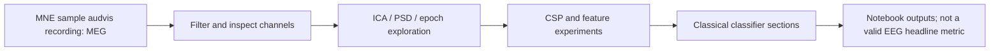

# EEG Signal Processing Exploration

An early MNE signal-processing notebook exploring filtering, ICA, spectral features, epochs, and classical classification; the bundled MNE sample recording is **MEG**, not EEG.

## Results

The notebook contains a five-fold mean accuracy of **69.4%** in one classifier section and additional single-split scores, but these must not be presented as EEG/BCI performance: the loaded `sample_audvis_raw.fif` recording is MEG, and the notebook also contains a random-label classifier section. No defensible EEG benchmark is established.

## Architecture

## Quickstart and verification

The notebook's saved output shows MNE downloading the 1.6 GB sample archive and loading a 60-channel recording. This historical notebook output was inspected, not rerun locally. To attempt it, install `requirements.txt` and open `eeg_exploration.ipynb`; the download requires network access and several gigabytes of free space.

## Limitations

- The main sample is MEG despite the repository's EEG framing.
- A random-label section makes its accuracy outputs unsuitable as evidence.
- The large sample-data download makes first-run setup slow and storage-intensive.
- No clean held-out EEG classification protocol is documented.

## Next steps

1. Rename/reframe the work as MNE MEG exploration or switch to a clearly documented EEG dataset.
2. Remove random-label results from the main narrative and label them as a sanity check.
3. Separate signal-processing demonstrations from classifier evaluation.
4. Add a small, deterministic smoke test that avoids downloading the full sample dataset.
